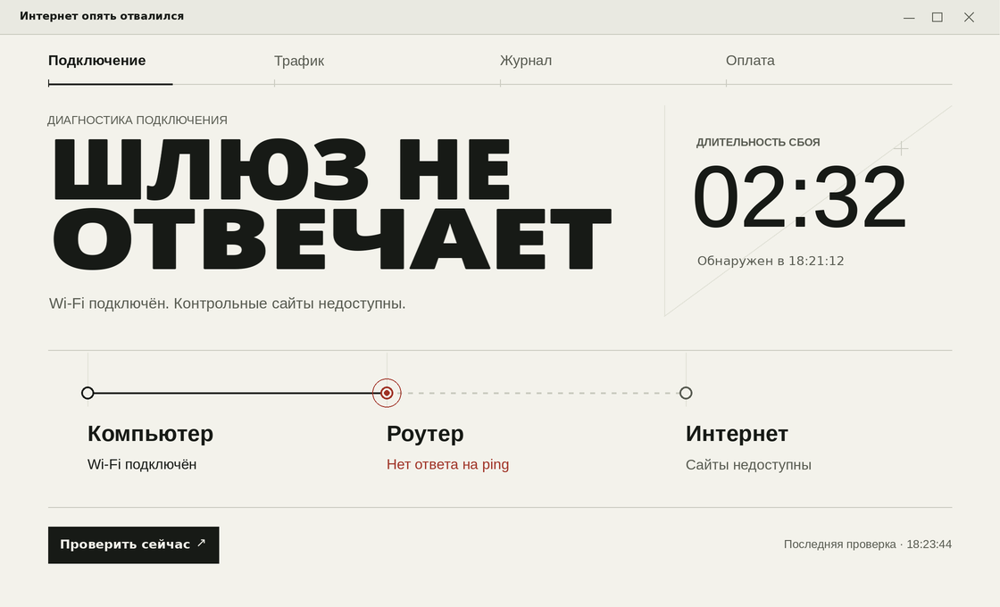

# Интернет опять отвалился

Настольное приложение для Windows 10 x64. Проверяет подключение, ведёт журнал сбоев, считает трафик по программам и напоминает об оплате интернета.

[Открыть мобильную веб-версию](https://mihailmoskalenko08-eng.github.io/internet-again/mobile/)

## Возможности

| Раздел | Что показывает |
| --- | --- |
| Подключение | Статус Wi‑Fi и активного адаптера, ответ и задержку шлюза, результат проверки интернета |
| Трафик | Текущую входящую и исходящую скорость и объём за день по программам |
| Журнал сбоев | Начало, восстановление, этап и примерную длительность сбоя. Есть экспорт отчёта |
| Оплата | Дату оплаты и напоминание за выбранное количество дней |

«Маршрут» использует принципы [SANTAL Architecture](https://santalarch.com/): крупный заголовок, чертёжные линии и минимум акцентов. Таймер показывает время с начала текущего сбоя, а красная точка на линии отмечает этап проверки, на котором обнаружена проблема.

При смене раздела экран плавно скользит, а чёрное подчёркивание сжимается и разворачивается под выбранной вкладкой. Во время проверки по маршруту проходит точка. При сбое метка мягко пульсирует. Если в Windows отключены анимации, переходы мгновенные и метка статичная.

[Интерактивный предпросмотр](docs/interface-preview.html) показывает переходы между всеми четырьмя разделами и переключается между примером сбоя и рабочей сетью. Откройте HTML-файл в браузере из распакованной папки. Предпросмотр использует демонстрационные данные.

## Запуск

1. Скачайте архив ветки [main](https://github.com/mihailmoskalenko08-eng/internet-again/archive/refs/heads/main.zip) и распакуйте его в новую папку с правом записи. Если работает предыдущая версия, закройте её через **Выйти** в меню значка в области уведомлений.
2. Запустите `Start.cmd`. При первом запуске скрипт соберёт `InternetAgain.exe` встроенным компилятором .NET Framework. Дальше можно открывать сам EXE.
3. Чтобы собирать трафик, откройте вкладку **Трафик**, нажмите **Включить учёт трафика** и подтвердите запуск от администратора. Используйте ту же учётную запись Windows, чтобы подхватить ваши настройки и журнал.

Требуется .NET Framework 4.6 или новее. Для самой сборки скачивать пакеты не нужно. Если изменили исходники, удалите ранее собранный `InternetAgain.exe` перед повторным запуском `Start.cmd`.

Крестик сворачивает приложение в область уведомлений. Чтобы остановить мониторинг, выберите **Выйти** в меню значка. На вкладке **Оплата** можно включить обычный запуск при входе в Windows. Учёт трафика после такого запуска можно снова включить с повышением прав.

## Как работают проверки

- **Подключение.** Приложение каждые восемь секунд проверяет Wi-Fi и активный адаптер, отправляет ping шлюзу и проверяет контрольные адреса Google и Cloudflare по HTTPS. Достаточно корректного ответа от одного из них. Роутер может блокировать ping даже при работающем интернете. Для шлюза показываются задержка последнего успешного запроса и число запросов без ответа среди последних 12 замеров.
- **Трафик.** Windows ETW сообщает объёмы передачи TCP и UDP с PID. Приложение показывает среднюю скорость за пять секунд и суммирует объёмы по пути к программе за местные сутки. В таблице учитывается трафик, который наблюдался во время работы счётчика, включая локальный TCP/UDP. Если Windows не дала определить программу, в таблице будет PID.
- **Журнал.** Время начала и конца берётся по результатам проверок, поэтому длительность приблизительная. После сна, закрытия приложения или длинного промежутка без замеров незавершённая запись отмечается как прерванная. Кнопка **Сохранить отчёт** выгружает текстовый файл с последней проверкой и журналом.
- **Оплата.** Можно задать одну дату и выбрать от 0 до 30 дней до уведомления. Приложение напоминает заранее, в день оплаты и при первом запуске после просрочки, если соответствующее уведомление ещё не отправлялось. Для показа всплывающего напоминания действуют настройки уведомлений Windows.

Данные хранятся локально в `%LOCALAPPDATA%\InternetAgain`. Отчёт сохраняется в выбранный файл. Интеграции с провайдером и роутером зависят от их API.

## Состояние версии

Ветка `main` содержит Windows-приложение с интерфейсом «Маршрут» на базе [предварительной версии v0.1.0](https://github.com/mihailmoskalenko08-eng/internet-again/releases/tag/v0.1.0). Сборка и проверка на Windows 10 ещё не выполнены.

Из бонусных функций доступны отчёт для провайдера, задержка и доля запросов без ответа до шлюза. Для баланса и статуса оплаты нужна интеграция с API провайдера. Для списка устройств и трафика по ним нужен доступ к данным роутера. Уровень сигнала Wi‑Fi пока не измеряется.

## Проверка на Windows

- Переключитесь между всеми четырьмя вкладками и проверьте скольжение в обе стороны. Отключите эффекты анимации в настройках Windows и проверьте мгновенное переключение.
- Откройте вкладку **Подключение** на рабочей сети. Отключите Wi-Fi и кабель, дождитесь записи в журнале, затем восстановите подключение.
- Включите учёт трафика и скачайте файл в браузере. В таблице должны вырасти входящая скорость и суточный счётчик браузера. Перезапустите приложение и проверьте суточный итог.
- Укажите завтрашнюю дату и напоминание за один день. Проверьте всплывающее уведомление и сохранение даты после перезапуска.
- Сохраните отчёт из журнала и откройте его в Блокноте.
